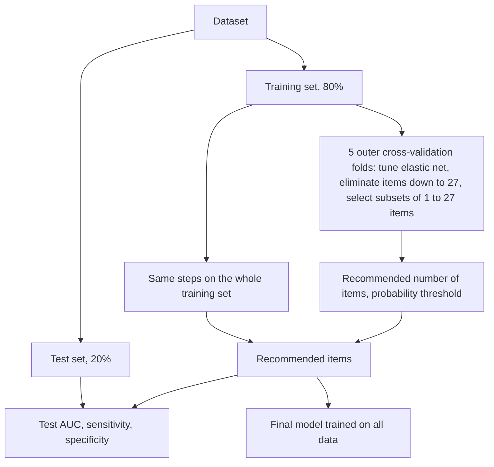

# Item recommender

[](https://github.com/charlie42/item_recommender/actions/workflows/tests.yml)

Item recommender takes questionnaire responses and binary outcomes, such as diagnoses, and recommends a short screener for each outcome. It reports the screener's items, its AUC on held-out data, the probability threshold that reaches the target sensitivity (80% by default) in cross-validation, and the sensitivity and specificity at that threshold on held-out data.

## Examples

- Datasets: NHIS sample child and sample adult files (2019 and 2022 pooled), NHANES questionnaires (2017 to March 2020)
- Outcomes: self-reported diagnoses ("Has a doctor or other health professional ever told you that you had...")
- Items with more than 40% missing values are excluded

In each figure, the blue line is the cross-validated AUC for each number of items, the dashed line is the AUC with all items, the vertical line is the recommended number of items and the orange dot is the test set AUC of the recommended items.

Sensitivity and specificity are measured on the test set. The full results, with survey variable names, item stability and coefficients, are in `results/<example>/recommended_items.csv`.

### NHIS child

- Participants: 13,090 children aged 4 to 17, reported by a parent
- Items (68, 50 after the missing value filter):
  - Strengths and Difficulties Questionnaire (SDQ) with its impact items
  - how often the child seems sad or anxious
  - difficulties with seeing, hearing, mobility, self care, communication, learning, memory, behavior
  - general health, asthma, diabetes
  - adverse childhood experiences
  - food insecurity
  - school days missed
- Outcomes: ADHD, autism, learning disability, developmental delay, intellectual disability


| Outcome | Items | Test AUC | Sensitivity | Specificity |
|---|---|---|---|---|
| Intellectual disability | overall difficulties, difficulty learning | 0.91 | 0.72 | 0.94 |
| Autism | overall difficulties, difficulty learning, difficulty accepting changes in routine | 0.90 | 0.81 | 0.84 |
| Learning disability | easily distracted, overall difficulties, difficulty learning | 0.89 | 0.86 | 0.76 |
| ADHD | easily distracted, good attention span, overall difficulties | 0.86 | 0.76 | 0.83 |
| Developmental delay | overall difficulties, difficulty being understood outside the household, difficulty learning, school days missed | 0.86 | 0.84 | 0.68 |

"Overall difficulties" is the SDQ impact question "Overall, do you think that [child] has difficulties in one or more of the following areas: emotions, concentration, behavior, or being able to get along with other people?".

### NHIS adult

- Participants: 59,648 adults
- Items (56, 49 after the missing value filter):
  - PHQ-8, GAD-7
  - frequency and level of depression and anxiety
  - general health, BMI category
  - 13 chronic conditions
  - difficulties with seeing, hearing, walking, communication, memory, self care, daily activities
  - smoking, vaping
  - food insecurity
- Outcomes: depression, anxiety


| Outcome | Items | Test AUC | Sensitivity | Specificity |
|---|---|---|---|---|
| Depression | how often depressed, how often anxious, difficulty remembering or concentrating | 0.87 | 0.76 | 0.81 |
| Anxiety | general health, feeling nervous or on edge (GAD-7), how often depressed, how often anxious | 0.86 | 0.82 | 0.75 |

#### Without mental health items

The same analysis without the mental health items, to find which other health items predict depression and anxiety. The excluded items are listed in `scripts/build_nhis.py`.


| Outcome | Items | Test AUC | Sensitivity | Specificity |
|---|---|---|---|---|
| Depression | general health, asthma, arthritis, difficulty seeing, ever vaped, worried food would run out | 0.72 | 0.76 | 0.54 |
| Anxiety | general health, asthma, arthritis, difficulty seeing, ever vaped, couldn't afford balanced meals | 0.70 | 0.74 | 0.53 |

### NHANES

- Participants: 9,232 adults
- Items (154, 93 after the missing value filter): depression, sleep, general health, weight history, physical activity, alcohol, smoking, cardiovascular and diet questionnaires, age, sex
- Outcomes: 14 diagnoses


| Outcome | Items | Test AUC | Sensitivity | Specificity |
|---|---|---|---|---|
| Heart failure | age, general health, greatest weight, chest pain | 0.91 | 0.86 | 0.79 |
| Angina | age, general health, chest pain | 0.90 | 0.92 | 0.75 |
| Heart attack | age, sex, general health, chest pain | 0.90 | 0.84 | 0.79 |
| Coronary heart disease | age, sex, chest pain | 0.88 | 0.84 | 0.78 |
| COPD | age, general health, smoked 100 cigarettes, short of breath on stairs | 0.83 | 0.85 | 0.66 |
| Arthritis | age, trouble sleeping, general health, greatest weight | 0.82 | 0.81 | 0.70 |
| Diabetes | age, general health, weight 10 years ago | 0.82 | 0.78 | 0.72 |
| Cancer | age, trouble sleeping | 0.80 | 0.81 | 0.63 |
| Hypertension | age, general health, greatest weight | 0.79 | 0.77 | 0.68 |
| Stroke | age, general health | 0.78 | 0.77 | 0.64 |
| High cholesterol | age, trouble sleeping, ate fewer carbohydrates, chest pain | 0.76 | 0.77 | 0.63 |
| Thyroid problem | age, sex, trouble sleeping | 0.72 | 0.80 | 0.50 |
| Liver condition | age, moving or speaking slowly or too fast, trouble sleeping, general health, ate fewer carbohydrates, 4/5 drinks every day, chest pain | 0.71 | 0.77 | 0.49 |
| Asthma | age, trouble sleeping, sleepy during the day, short of breath on stairs | 0.68 | 0.82 | 0.44 |

### Reproducing the examples

```
pip install -r requirements.txt
make nhis MODE=PROD
make nhanes MODE=PROD
```

The survey files are downloaded to `data/`. The tables and figures are written to `results/`. Only items asked in both NHIS years are used.

## Method



For each outcome, 20% of the data is held out as the test set. On the rest:

1. Elastic net logistic regression is tuned on all items with a random hyperparameter search and inner cross-validation.
2. Recursive feature elimination narrows the items down to 27, then sequential forward floating selection builds subsets of 1 to 27 items.
3. This is repeated in 5 outer cross-validation folds. The recommended number of items is the smallest one whose mean AUC reaches 95% of the best improvement over chance (AUC 0.5).
4. Steps 1 and 2 are run on the whole training set, then the subset of the recommended size is evaluated on the test set. The final model is trained on all data with those items.

Missing item values are filled with the item's median from the training data of each fold.

Only binary outcomes are supported. Selecting a shared item set for multiple outcomes is not supported.

## Installation

```
git clone https://github.com/charlie42/item_recommender.git
cd item_recommender
pip install .
```

## Usage

```
item-recommender --data-path [DATA_PATH] --config-path [CONFIG_PATH] --mode [MODE]
```

Or, from the project directory:

```
make run DATA=[DATA_PATH]
```

[DATA_PATH] is your dataset in csv format. [CONFIG_PATH] is the config file. There is an example config in `example_config/`.

Dataset format:
- Output column names start with the output column prefix from the config ("Diag." by default) and contain 0 or 1. Rows with a missing value in an output column are skipped for that output.
- All other columns are items and should be numeric. Items with a larger fraction of missing values than `max missing fraction` are dropped.

The output goes to a directory named after the dataset file. It contains:
- `recommended_items.csv`: the recommended items for each output, each item's stability (the fraction of cross-validation folds that selected it) and coefficient on standardized responses, performance on the test set, the recommended probability threshold, and test sensitivity and specificity at that threshold.
- `results.joblib`: the recommended items, cross-validation and test set performance for every number of items, and the final model trained on all data with the recommended items.

The sign of a coefficient depends on how the item is coded. In NHIS, yes is coded 1 and no 2, so a negative coefficient means the predicted probability is higher for a yes answer. Such items can be recoded before running the recommender.

To run the tests:

```
pip install pytest
pytest
```

The tests plant items in a synthetic dataset and check that the recommender finds them.

## Options
- `--mode`: DEV (fast, for testing), DEBUG (default), or PROD. Each mode overrides the config settings listed under `modes` in the config file.

Config settings:
- `n features to check`: the maximum number of items to recommend.
- `percentage for opt n features`: the recommended number of items is the smallest one that reaches this percentage of the best performance improvement over chance.
- `target sensitivity`: the recommended probability threshold is the median across outer folds of the highest threshold that reaches this sensitivity. Sensitivity and specificity on the test set are reported at that threshold.
- `split percentage`: fraction of the data used as the test set.
- `outer cv n splits`, `inner cv n splits`: number of cross-validation folds.
- `hp search n iter`: number of hyperparameter combinations to try.
- `output column prefix`: prefix of the output column names.
- `min class size`: outputs with fewer positive (or negative) samples than this are skipped.
- `max missing fraction`: items with a larger fraction of missing values are dropped.
- `exclude columns`: columns that are neither items nor outputs, such as IDs or total scores.

## License
This project is licensed under the MIT License.
